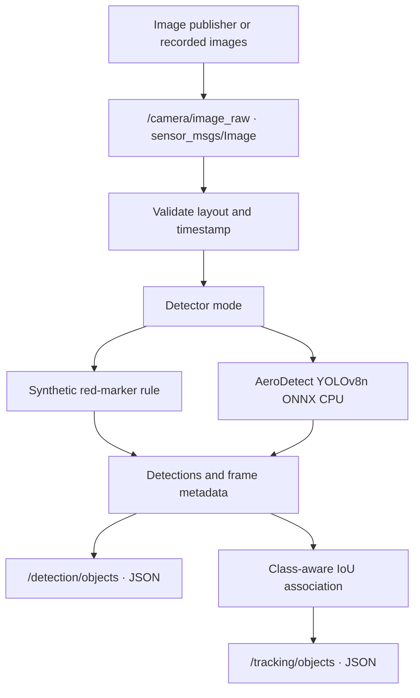

# AeroFusion-ROS2 · AeroDetect integration

  

A compact camera-perception demonstrator that connects the existing **AeroDetect-Lite YOLOv8n pipeline** to ROS 2. It reads image messages, publishes detections, and assigns object IDs with the existing class-aware IoU tracker.

This upgrade starts from the uploaded working Stage 2 package. Synthetic camera generation, the red-marker detector, camera monitor, recorded-image publisher and original tracker tests are retained. Real-image ONNX inference and the adapter were executed in the build environment. **ROS message transport, colcon builds and launch execution still require the WSL2 verifier below.**

## Why this exists

Students often have a detector that works in a terminal but no reliable way to connect it to a robotics application. AeroFusion makes that boundary inspectable: image layout, timestamps, boxes, class names, tracking IDs and processing times are exposed in small JSON messages. It can help students and developers test an offline perception pipeline before considering hardware.

## Architecture



## What changed

- Added a shared, ROS-independent `PerceptionPipeline`; the ROS callback uses this same tested path.
- Added `/detection/objects` alongside the existing `/tracking/objects` topic.
- Preserved tracking fields and added schema version, dimensions, reset reason indicator and tracking scope.
- Accepts packed or padded RGB8/BGR8 rows. Unsupported encodings and malformed buffers fail clearly.
- Loads AeroDetect under a path-specific package alias, avoiding accidental collisions with other modules named `src`.
- Resets association on camera changes, resolution changes, timestamp rewinds and explicitly independent still images.
- Publishers wait for a subscriber before starting, then allow two seconds for the last frame to drain before finite-demo shutdown. Discovery failure has a bounded timeout.
- Added isolated runtime dependencies, focused integration tests, a real-image offline checker and actual ROS topic verification.

## One automated WSL2 verification command

Extract the updated bundle into your Ubuntu home directory so the folders are siblings:

```text
AeroDetect-Lite/
aerofusion_ros2/
VERIFICATION_REPORT.md
```

In **WSL2 Ubuntu**, from that extracted directory, run:

```bash
bash aerofusion_ros2/scripts/verify_all.sh "$PWD/AeroDetect-Lite"
```

This is the single remaining execution step. It automatically downloads hash-checked original assets, exports ONNX, creates two isolated environments, runs both test suites, measures CPU inference, checks the adapter, builds a fresh colcon workspace, verifies real ROS topics, and exercises both launch paths. It does not alter your current workspace or install packages globally.

Prerequisites: Ubuntu 24.04, matching `/usr/bin/python3` 3.12 with venv support, ROS 2 Jazzy at `/opt/ros/jazzy`, colcon installed for that system Python, and internet access to Python package indexes and the linked GitHub releases. Missing prerequisites stop the script with a nonzero status. Model/data download failure also stops verification. Existing Windows-native Python installations do not satisfy WSL requirements.

Evidence is saved to a unique `~/aerofusion_verification/run-*` directory. This includes full logs, JUnit reports, raw benchmark CSVs, package versions, offline adapter output, ROS topic checks and launch logs. `AEROFUSION_VERIFY_ROOT` can select a different output parent.

### How dependency isolation works

The exporter uses a plain venv for PyTorch/Ultralytics. ROS nodes use a separate system-Python venv with `--system-site-packages`, preserving access to apt-installed ROS and colcon. Its requirements pin **setuptools below 80**, NumPy 1.26.4 and OpenCV 4.11. No cv_bridge dependency is introduced. The script checks imports, `pip check`, the setuptools version and the generated node's interpreter before accepting a build.

The isolated runtime requirements passed `pip check` here. Compatibility with the packages already installed on your WSL system must still be checked there; the script fails instead of hiding conflicts. It uses a new build directory to avoid old executable shebangs. Environments contain `COLCON_IGNORE` files and live outside workspace `src`.

## Topics and message contract

| Topic | Type | Meaning |
|---|---|---|
| `/camera/image_raw` | `sensor_msgs/msg/Image` | RGB8/BGR8 input, row step and timestamp preserved |
| `/detection/objects` | `std_msgs/msg/String` | JSON `objects`: label, confidence and original-pixel `bbox_xyxy` |
| `/tracking/objects` | `std_msgs/msg/String` | JSON `tracks`: persistent IDs, boxes, labels and observed age |

Both output payloads include `schema_version`, `source`, `frame_id`, `stamp_ns`, `image_number`, `width`, `height`, `association_reset`, `tracking_scope` and `processing_ms`. The tracking topic retains its existing numeric `detections` field. `processing_ms` measures the shared detector/tracker processing path, excluding DDS transport and JSON serialization.

Source is `red-square-rule` in synthetic mode and `aerodetect-onnx-yolov8n` in ONNX mode. JSON is a project-specific interface; it is not `vision_msgs/Detection2DArray`. Topic names can use normal ROS remapping. Depth-10 reliable/volatile QoS is retained for this controlled replay demo; use a compatible publisher configuration.

## Independent images versus sequences

For the VisDrone **DET still-image subset**, set `reset_each_frame:=true`. Each image is processed independently; an ID belongs to that image and can be reused after a reset. An identity is scoped by camera and reset epoch, not globally unique across resets.

For chronologically ordered frames from **one actual sequence**, leave the flag false. IDs can persist when boxes overlap sufficiently and labels agree. The current greedy IoU tracker can switch IDs during crowd overlap, large motion and occlusion. There are no MOTA, IDF1 or HOTA results. Repeating an identical real photograph checks stable software association only; it does not validate tracking on real video.

After the automated verifier builds the package, its log contains the fresh workspace location. To use the existing launch manually in a correctly sourced ROS environment:

```bash
ros2 launch aerofusion_ros2 tracking_onnx.launch.py \
  image_dir:=/absolute/path/to/images \
  aerodetect_root:=/absolute/path/to/AeroDetect-Lite \
  onnx_path:=/absolute/path/to/AeroDetect-Lite/yolov8n.onnx \
  reset_each_frame:=true fps:=1.0 max_frames:=10
```

Synthetic mode remains `ros2 launch aerofusion_ros2 tracking_demo.launch.py`. The original continuous camera demo and monitor also remain available.

## Verification evidence

See [INTEGRATION_VERIFICATION.md](INTEGRATION_VERIFICATION.md) for the current executed results. The historical Stage 2 report and test log are retained as historical evidence. The new ROS script checks 30 synthetic frames and three repeated real-image frames through actual rclpy/DDS, preserves timestamps and labels, verifies persistent IDs and rejects malformed input. It **has not run in this build environment**, which has no rclpy, ROS installation or colcon.

Focused tests use small generated images and a tiny constant ONNX fixture where appropriate. That fixture tests the adapter contract and is never used for latency or accuracy claims. Real-image integration evidence uses the genuine exported YOLO model and original hash-checked VisDrone inputs.

## Model, data and licensing

The model was pretrained by Ultralytics on COCO; no training was performed for this project. Its COCO categories do not cover the full VisDrone label set. Precision, recall and mAP remain **NOT EVALUATED**. The full dataset and weights are not bundled. AeroDetect includes attributed sample outputs and asset provenance.

The ROS package retains its MIT license. AeroDetect source and Ultralytics components carry AGPL-3.0 / applicable Ultralytics terms. Loading those components does not remove their license obligations. VisDrone originals and derivative examples retain their separate noncommercial dataset terms. See the sibling AeroDetect README for attribution and source links.

No TensorRT, CUDA, physical drone, sensor fusion, Jetson deployment or real-time hardware claim is made.

References: [ROS 2 Jazzy](https://docs.ros.org/en/jazzy/), [ROS Python environment guidance](https://github.com/ros2/ros2_documentation/blob/rolling/source/Developer-Tools/Build/Using-Python-Packages.rst), [AeroDetect repository](https://github.com/yusufthecoder474/AeroDetect-Lite).
